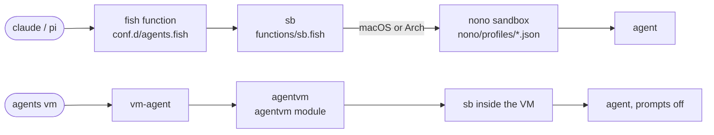
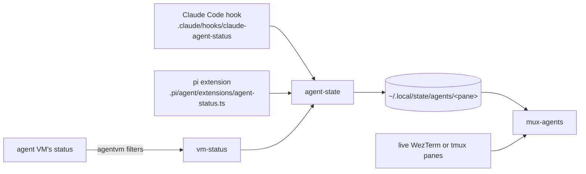

# Agents module

Claude Code and pi, their sandboxes, and the tools around them. `setup/link`
links every file here into `~` except this file.

## Launching an agent

- `sb` picks the nono profile that matches the agent, installs the shared skills
  once, and records sandbox denials for `agents trace`.
- nono's credential proxy adds the Claude and GitHub tokens to requests, so the
  agent never holds them.
- `agents vm` runs the agent in a VM instead, through the
  [`agentvm` module](../agentvm/README.md). `vm-agent` adds Claude's credentials
  profile, its transcripts, and the picker. `.config/agentvm/guest.d/agents.sh`
  sets up the agent inside the VM.

## The `agents` command

`.local/bin/agents` dispatches to the scripts in `.local/libexec/agents/`:

| Command         | Script         | Role                                              |
| --------------- | -------------- | ------------------------------------------------- |
| `agents`        | `mux-agents`   | Picker across WezTerm workspaces or tmux sessions |
| `agents state`  | `agent-state`  | Reads and writes the state the picker shows       |
| `agents task`   | `agent-state`  | Publishes this pane's task summary                |
| `agents trace`  | `agent-trace`  | Reports failed tool calls and sandbox denials     |
| `agents skills` | `agent-skills` | Refreshes the shared skills from upstream         |
| `agents vm`     | `vm-agent`     | Claude Code or a shell in the agent VM            |

## The picker

The pane the agent runs in keys each entry. The picker joins the entries against
the live panes, so an agent whose pane closed drops out.

An agent in the agent VM can't write these entries. Its agent-state writes into
the status folder of the VM, which `agentvm` reads and filters. `vm-status`
checks the state and writes the entry for the pane of the VM only.

## Other pieces

- `.agents/AGENTS.md` holds the instructions every agent reads.
  `.claude/CLAUDE.md` and `.pi/agent/AGENTS.md` point to it.
- `.agents/skills/` holds the tracked skills. `agent-skills` installs the
  upstream ones next to them.
- `.claude/hooks/` blocks Git history rewrites in jj repositories, session
  trailers in commits, and sandbox bypasses under nono. It also draws the status
  line.
- `.config/tmux/conf.d/agents.conf` binds the picker and the agent VM in tmux.
  WezTerm's bindings live in the `wezterm` module.
