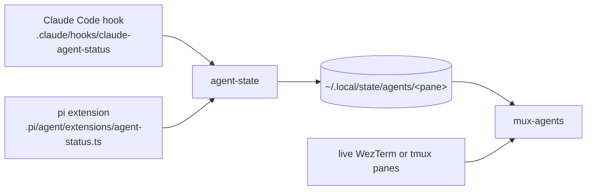

# Agents module

Claude Code and pi and the tools around them. `setup/link` links every file here
into `~` except this file.

## Launching an agent

The `claude` and `pi` fish functions in `conf.d/agents.fish` install their agent
on first use, install the shared skills once through `agent-skills`, and run the
agent. `command <agent>` skips the function.

## The `agents` command

`.local/bin/agents` dispatches to the scripts in `.local/libexec/agents/`:

| Command         | Script         | Role                                              |
| --------------- | -------------- | ------------------------------------------------- |
| `agents`        | `mux-agents`   | Picker across WezTerm workspaces or tmux sessions |
| `agents state`  | `agent-state`  | Reads and writes the state the picker shows       |
| `agents task`   | `agent-state`  | Publishes this pane's task summary                |
| `agents trace`  | `agent-trace`  | Reports failed tool calls                         |
| `agents skills` | `agent-skills` | Refreshes the shared skills from upstream         |

## The picker

The pane the agent runs in keys each entry. The picker joins the entries against
the live panes, so an agent whose pane closed drops out.

## Other pieces

- `.agents/AGENTS.md` holds the instructions every agent reads.
  `.claude/CLAUDE.md` and `.pi/agent/AGENTS.md` point to it.
- `.agents/skills/` holds the tracked skills. `agent-skills` installs the
  upstream ones next to them.
- `.claude/hooks/` blocks pushes, Git history rewrites in jj repositories, and
  session trailers in commits. It also draws the status line.
- `.config/tmux/conf.d/agents.conf` binds the picker in tmux. WezTerm's bindings
  live in the `wezterm` module.
