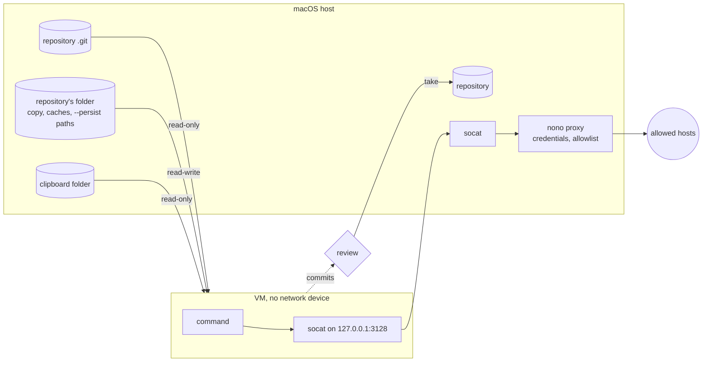
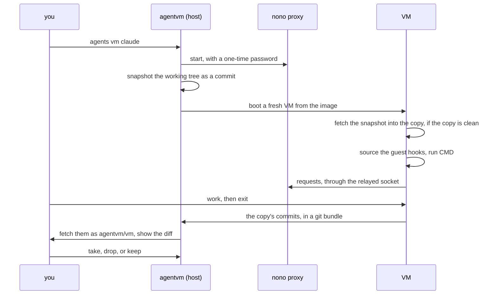
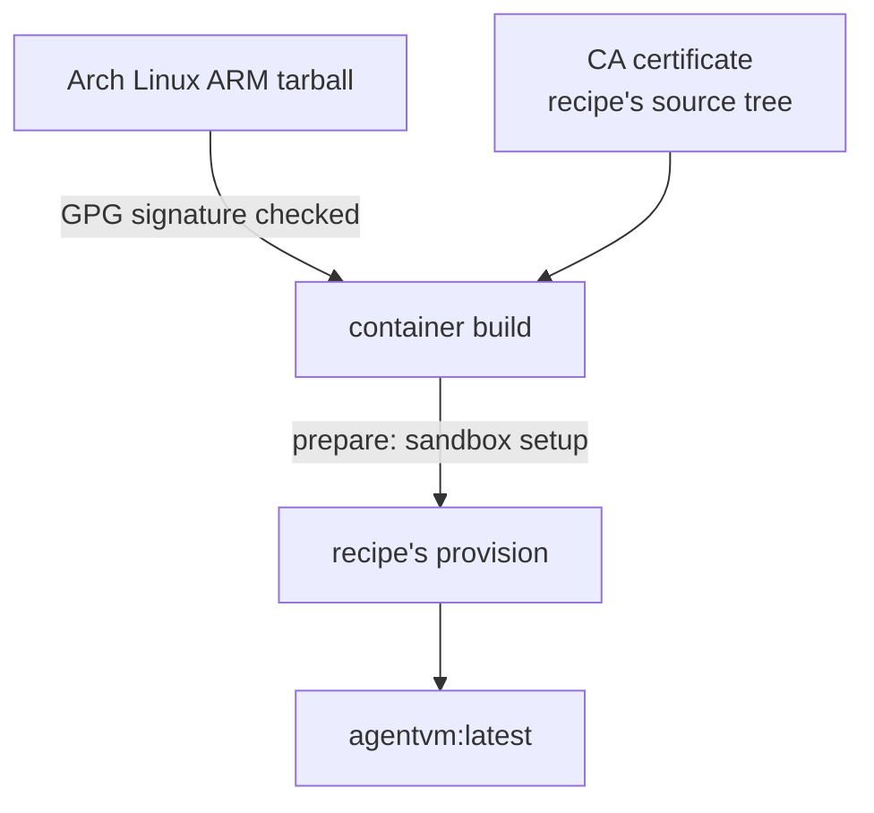

# `agentvm` module

`agentvm` runs a command, such as a coding agent, in a Linux microVM on Apple's
[`container`](https://github.com/apple/container). The VM has no network device,
and a socket to a credential proxy on the host forms its only way out. Work
happens on a copy of the repository and comes back as commits you review.
`setup/link` links every file here into `~` except this file.

You use it through `agents vm`, whose `help` shows the commands. The header of
the [`agentvm`](.local/libexec/agentvm/agentvm) script documents the engine's
options. This page explains the design and the contract with callers.

## Files

```text
.local/libexec/agentvm/
  agentvm                          options and the session's flow
  host/                            sourced by agentvm
    common.sh                      paths, the proxy's CA, the snapshot
    proxy.sh  vm.sh                the proxy and the VM
    status.sh  review.sh           the status channel and the patch review
    build.sh                       agentvm build
  guest/session.sh                 runs in the VM around the command
  image/Containerfile, prepare.sh  the image build
.config/nono/profiles/agentvm.json the hosts the VM reaches
```

## Shares in a session



- The copy, the caches, and the `--persist` paths belong to one repository.
  Another repository's VM never gets them.
- The proxy reaches only the hosts in
  [`agentvm.json`](.config/nono/profiles/agentvm.json). A machine adds hosts in
  `~/.config/nono/profiles/agentvm-local.json`, which stays out of the repo. A
  work machine could use:

  ```json
  {
    "meta": {
      "name": "agentvm-local",
      "version": "1.0.0",
      "description": "Work hosts"
    },
    "network": {
      "allow_domain": ["repo.maven.apache.org", "*.corp.example.com"]
    }
  }
  ```

- Callers add credentials by stacking more profiles with `--extends`.

## A session



Host git never runs inside the copy. The guest writes the copy, so its git
config and hooks could run code on the host. Only the commits cross back, and
their diff applies only after you read it.

## Contract with callers

`agentvm` handles any command the same way. A caller hooks in at three points:

- **Host options:** `--extends` stacks a nono profile with credentials, `--env`
  sets a variable, and `--persist` keeps a path under the guest's home.
- **Guest hooks:** the guest session sources every
  `~/.config/agentvm/guest.d/*.sh` in the image before the command starts.
- **Status:** a hook may write one-line files to `$AGENTVM_STATUS`. The host
  passes each change to the `--on-status` command as `NAME VALUE`. It reads
  regular files only, with names from a fixed character set, and passes
  printable text only, so a guest can't reach the host's terminal or files
  through it.

The [agents module](../agents/README.md) uses all three for `agents vm`.

## Building the image



`agentvm build` builds the image. `image/prepare.sh` sets up what the sandbox
needs: the proxy's CA, git, `socat`, and a user with the host's IDs. Then it
runs this repo's recipe,
[`setup/agentvm/provision`](../../setup/agentvm/provision), which installs the
dotfiles and their tools. The build has a network device and runs downloaded
install scripts, so it gets only the dotfiles' tracked and untracked files and
the certificate of the CA. It never gets the key of the CA or the repository
copies.

## Where things live

| Path                             | Holds                              |
| -------------------------------- | ---------------------------------- |
| `~/.local/share/agentvm/`        | the verified Arch Linux tarball    |
| `~/.local/state/agentvm/ca.*`    | the proxy's CA                     |
| `~/.local/state/agentvm/copies/` | one folder per repository          |
| `container image list`           | the image, `agentvm:latest`        |
