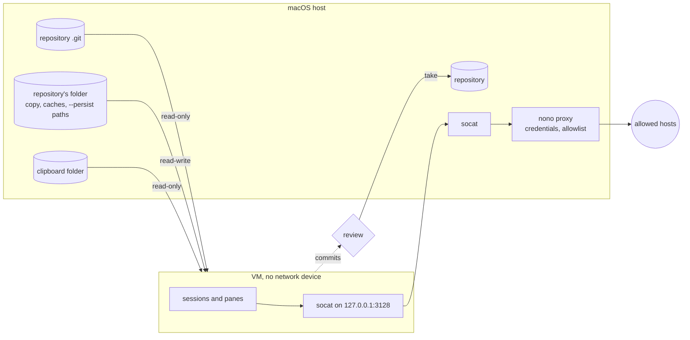
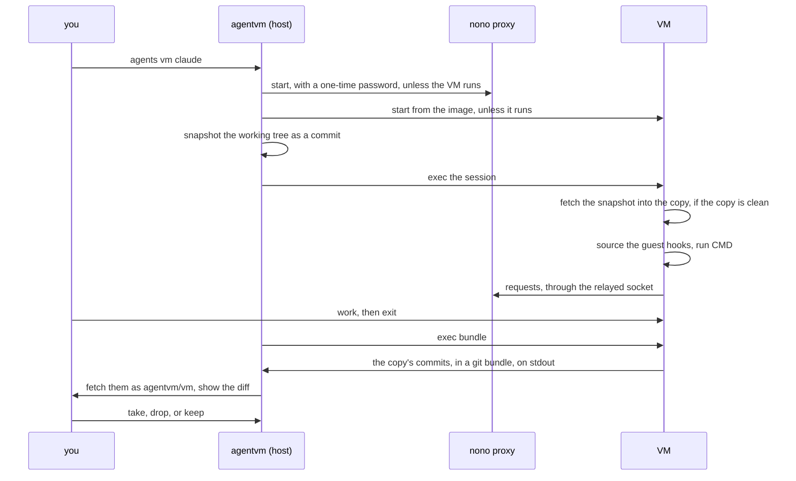
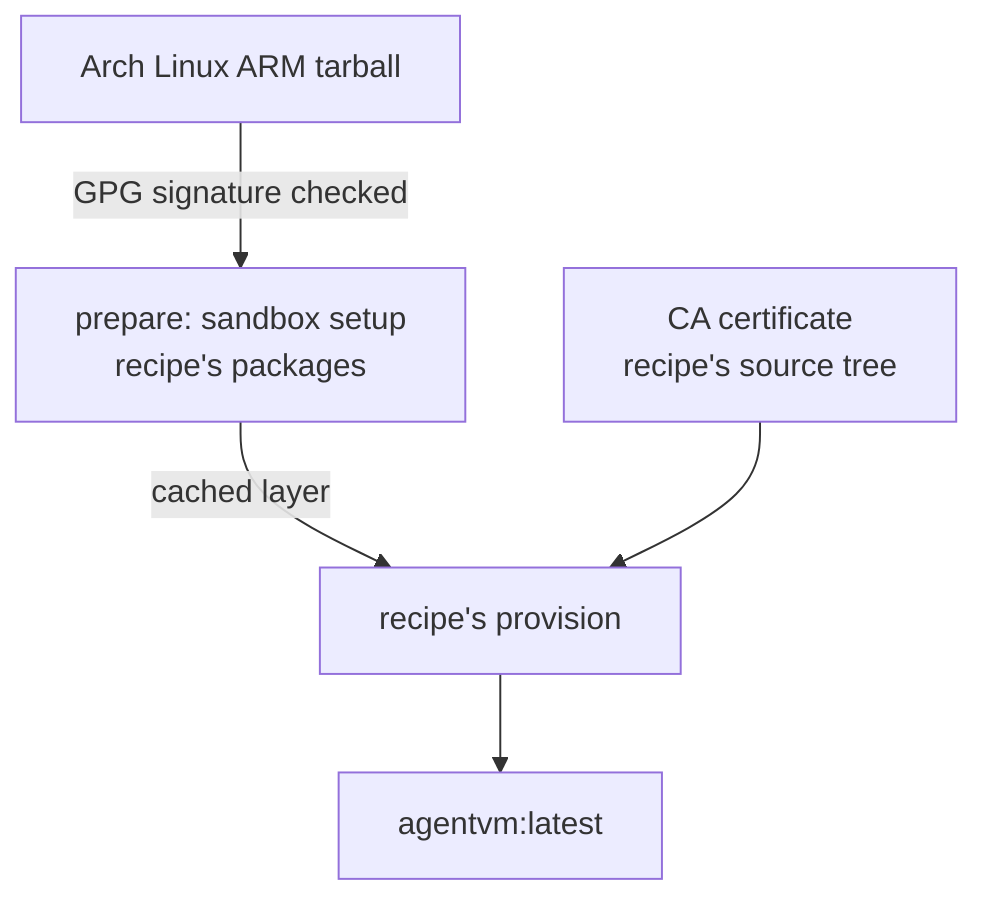

# `agentvm` module

`agentvm` runs a command, such as a coding agent, in a Linux microVM on Apple's
[`container`](https://github.com/apple/container). The VM has no network device,
and a socket to a credential proxy on the host forms its only way out. Work
happens on a copy of the repository and comes back as commits you review.
`setup/link` links every file here into `~` except this file.

You use it through `agents vm`, whose `help` shows the commands. The header of
the [`agentvm`](.local/libexec/agentvm/agentvm) script documents the engine's
options. This page explains the design and the contract with callers.

## Files

```text
.local/libexec/agentvm/
  agentvm                          the host side: proxy, VM, status, review, build
  guest/session.sh                 runs in the VM, from a read-only share of
                                   this folder: serve, sessions, bundle, reset
  image/Containerfile, prepare.sh  the image build
.config/nono/profiles/agentvm.json the hosts the VM reaches
```

## One sandbox per repository



The first session starts the repository's VM, with its proxy and bridge, and
`agents vm stop` ends it. Every later session, pane, `take`, and `drop` runs
inside it through `container exec`, so it pays no boot. `agents vm ls` lists the
VMs. The VM's runtime lives in the repository's folder under `run/`, which only
the host writes.

- The copy, the caches, and the `--persist` paths belong to one repository.
  Another repository's VM never gets them.
- The shares, the ports, the size, and the proxy's profiles come from the
  session that started the VM. A later session's profiles join the proxy's,
  which restarts on its port, so every session keeps what it had.
- The proxy reaches only the hosts in
  [`agentvm.json`](.config/nono/profiles/agentvm.json). A machine adds hosts in
  `~/.config/nono/profiles/agentvm-local.json`, which stays out of the repo. A
  work machine could use:

  ```json
  {
    "meta": {
      "name": "agentvm-local",
      "version": "1.0.0",
      "description": "Work hosts"
    },
    "network": {
      "allow_domain": ["repo.maven.apache.org", "*.corp.example.com"]
    }
  }
  ```

- Callers add credentials by stacking more profiles with `--extends`. The
  proxy's log, `run/proxy.log`, shows what it refused.
- `--mount PATH:ro` shares a host path read-only. Without `:ro` the guest writes
  the host path directly, past the review.
- `--publish PORT` serves the guest's port on the host's loopback, through a
  socket that `container` relays.

## A session



Host git never runs inside the copy. The guest writes the copy, so its git
config and hooks could run code on the host. Only the commits cross back, on the
guest's stdout, and their diff applies only after you read it. The host keeps
each snapshot under `refs/agentvm/snapshot`, so a copy kept for weeks still
builds on a commit the repository has.

## Contract with callers

`agentvm` handles any command the same way. A caller hooks in at three points:

- **Host options:** `--extends` stacks a nono profile with credentials, `--env`
  sets a variable, and `--persist` keeps a path under the guest's home.
- **Guest hooks:** the guest session sources every
  `~/.config/agentvm/guest.d/*.sh` in the image before the command starts.
- **Status:** a hook may write one-line files to `$AGENTVM_STATUS`, a folder of
  the session's own, so sessions in one VM don't mix their status. The host
  passes each change to the `--on-status` command as `NAME VALUE`, and runs it
  alone when the session ends. It reads regular files only, with names from a
  fixed character set, and passes printable text only, so a guest can't reach
  the host's terminal or files through it.

The [agents module](../agents/README.md) uses all three for `agents vm`.

## Building the image



`agentvm build` builds the image in two layers. `image/prepare.sh` sets up what
the sandbox needs, the proxy's CA, git, `socat`, and a user with the host's IDs,
then runs the recipe's package script,
[`setup/agentvm/packages`](../../setup/agentvm/packages), which installs the
sandbox packages and the toolchains. The builder caches that layer until the
scripts, the package list, or the CA change. The last layer runs the recipe's
[`setup/agentvm/provision`](../../setup/agentvm/provision) on the dotfiles'
tree, which installs the dotfiles and the editor's plugins, so a build after a
dotfiles change redoes that layer only. `agents vm build --fresh` empties the
builder and rebuilds both, which also brings the packages up to date. Each build
stops the builder at its end, and the cache stays.

`agents vm prune` stops every VM and frees the stopped containers, the builder
with its cache, and the images nothing names. The copies stay.

The build has a network device and runs downloaded install scripts, so it gets
only the dotfiles' tracked and untracked files and the certificate of the CA. It
never gets the key of the CA or the repository copies.

## Where things live

| Path                                  | Holds                           |
| ------------------------------------- | ------------------------------- |
| `~/.local/share/agentvm/`             | the verified Arch Linux tarball |
| `~/.local/state/agentvm/ca.*`         | the proxy's CA                  |
| `~/.local/state/agentvm/copies/`      | one folder per repository       |
| `~/.local/state/agentvm/copies/*/run` | a VM's proxy, bridge, and log   |
| `container image list`                | the image, `agentvm:latest`     |
